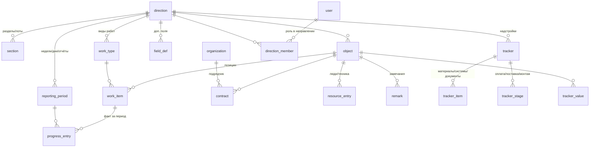

# МВС СТ — производственный дашборд → корпоративное приложение

**Шаг 1. Анализ исходного дашборда, предложение стека, модели данных и плана работ**
Дата: 28.10.2026 · Источник: `МВС_СТ_дашборд.zip` (оболочка `index.html` + 4 модуля + исходники сборки)

---

## 1. Что сейчас есть

### 1.1. Устройство

| Часть | Объём | Данные | Ввод |
|---|---|---|---|
| **Оболочка** (`index.html`) | вкладки направлений, «Сводка» для руководства, тема, общая резервная копия | кэш KPI модулей | — |
| **Школы** — капремонт 2026–2027 | 4 школы, 34 вида работ, 35 материалов, 39 систем | `objects{…}`, справочники, дневной журнал ресурсов | есть, по дням |
| **МКД** — капремонт 2026 | 42 адреса, 284 позиции, 17 видов работ, 5 лотов | позиции × отчётные недели (статус, %, КС-2, оплата) | есть, по неделям |
| **Сети** — сети, коллекторы, водные объекты | 154 объекта, 5 разделов, договоры, линии прокладки | объект × неделя (факт по линиям, КС, люди, техника) | есть, по неделям |
| **Благоустройство** — улицы (КБУ + текущий) | 32 объекта, 20 видов работ, 140 отчётов | снимки отчётов из Excel, карта, геокодинг | только просмотр |

Модули связаны с оболочкой через `postMessage` (мост `bridge.js`): модуль отдаёт показатели (KPI payload), оболочка — тему и команду «открыть объект».

### 1.2. Функционал по направлениям (что нужно повторить)

**Оболочка / «Производственная сводка»:** карточки направлений (объекты, факт/план, отстающие, критичные, люди, техника, деньги), «Деньги по направлениям» (портфель / КС-2 / оплачено), «Наибольшее отставание от графика» со ссылкой в карточку объекта, замечания (благоустройство), светофор статуса направления (факт−план < −2 п.п. — отставание, < −10 п.п. — критично), общая резервная копия.

**МКД:** Сводка · Объекты (таблица/плитки, сортировка по отставанию) · Матрица (адрес × вид работ) · Динамика (освоение нарастающим, прирост за неделю) · График работ (Гантт) · Финансы (структура стоимости: оплачено / к оплате / прогноз / экономия) · Ответственные · Качество данных (сверка с итоговой строкой Excel) · Панель управления (ввод за неделю, контроль заполнения, объекты и работы, справочники, журнал, данные, открытие новой недели, напоминания исполнителям). Фильтры: лот, группа работ, ответственный, поиск.

**Сети:** Обзор · Реестр объектов · Динамика (п.м, рабочие, техника по неделям) · Матрица недель · График работ · Финансы (договоры, аванс, освоение по КС, «деньги против физики») · Ответственные · Качество данных · Панель управления (редактор объектов, договоры, линии прокладки, организации, перенос/удаление, экспорт CSV/JSON).

**Школы:** Сводка · Направления (план/факт, круговые) · Динамика (люди/техника по дням) · Виды работ (Гантт, тепловая карта) · Закупки (оплата → поставка → монтаж по материалам) · Индивидуальные испытания (системы × объекты) · Объекты и карточка школы · Проектирование и МГЭ · Ввод данных · Справочники · Журнал · Экспорт .xlsx/.json · Режим презентации.

**Благоустройство:** Сводка · Виды работ · Динамика по датам отчётов · Замечания · Объекты · Матрица · Карта Москвы (офлайн-тайлы, геокодинг) · сравнение с предыдущим отчётом · режим презентации · расхождения сумм в исходном Excel.

### 1.3. Как считается готовность (сейчас — в коде каждого модуля)

| Направление | Факт | План на дату | Деньги | Период |
|---|---|---|---|---|
| Школы | Σ(вес вида × % выполнения) | линейно по срокам вида работ | лимит, оплачено | день |
| МКД | по позициям, взвешено стоимостью договора; КС-2/оплачено = 100 % | линейно по срокам позиции, на пятницу недели | договор, КС-2, оплачено, к оплате | неделя |
| Сети | факт/проект по линиям, итог взвешен договорами | линейно по срокам объекта | договоры, аванс, КС | неделя |
| Благоустройство | доля позиций, где факт ≥ проекта | нет графика | нет | отчёт |

### 1.4. Проблемы, которые решает приложение

1. **Данные живут в браузере** (localStorage) — их видит только тот компьютер, где внесли; передача файлами.
2. **Четыре разные модели данных** под одну и ту же суть «объект → работы → факт за период».
3. **Правила расчёта и пороги размазаны по модулям** (в МКД пороги −5/−15, в оболочке −2/−10).
4. **Нет пользователей и прав**: «кто внёс» — это строка с именем из выпадающего списка, а не учётная запись.
5. **Новое направление = новый HTML-файл** и правка оболочки.
6. **Справочники дублируются** (люди, подрядчики — свои в каждом модуле).
7. Встроенные демо-данные помечены «пример» (`ex`) — смешаны с реальными.

### 1.5. Главный вывод анализа

Все четыре направления — это одна и та же структура с разными «надстройками»:

```
Направление ─┬─ Разделы/лоты
             ├─ Виды работ (группа, ед. изм., вес)
             └─ Объекты (адрес, куратор, подрядчик, сроки)
                  ├─ Позиции работ (вид работ × объект: объём/стоимость, сроки, ответственный)
                  │     └─ Факт за период (статус, %, объём, КС-2, оплата, кто/когда)
                  ├─ Договоры
                  ├─ Ресурсы за период (люди, техника)
                  ├─ Замечания
                  └─ Трекеры-надстройки: закупки, испытания, МГЭ, документация…
```

Различия — в **настройках**: тип периода (день/неделя/отчёт), способ расчёта готовности, набор дополнительных полей и трекеров. Значит, БД строим **одну универсальную**, а особенности направления описываем **конфигурацией в БД**, а не кодом.

---

## 2. Предлагаемый стек

Учитывая MySQL и JS/React — остаёмся в экосистеме TypeScript целиком (одни типы и схемы на сервере и клиенте).

| Слой | Выбор | Почему |
|---|---|---|
| Язык | **TypeScript** везде | общие типы, валидация и расчёты KPI в одном пакете |
| Репозиторий | монорепо **pnpm workspaces** (`apps/api`, `apps/web`, `packages/shared`) | одна версия контрактов |
| Сервер | **Node.js 22 LTS + NestJS** | модульность (направление = модуль), guards для ролей, Swagger из коробки, привычен корпоративным командам |
| ORM / миграции | **Prisma** (+ сырой SQL для отчётных агрегатов) | миграции, типизированные запросы, поддержка JSON-полей MySQL |
| БД | **MySQL 8.0+** (InnoDB, utf8mb4) | JSON-колонки, оконные функции, CTE — нужны для KPI |
| Кэш / очереди | **Redis + BullMQ** (этап 2) | импорт Excel в фоне, пересчёт KPI, напоминания |
| Валидация | **Zod** (общие схемы для форм и API) | одна схема — и форма, и сервер |
| Авторизация | JWT в httpOnly-cookie → позже **SSO через AD/LDAP** (Keycloak или passport-ldap) | вход доменной учёткой |
| Клиент | **React 19 + Vite** | быстрая сборка |
| Маршруты / данные | **TanStack Router + TanStack Query** | типизированные адреса (`/mkd/objects/o12`), кэш и фоновое обновление |
| Таблицы | **TanStack Table** + виртуализация | реестры на сотни строк, редактирование в ячейках (ввод за неделю) |
| UI-кит | **Mantine 7** (или shadcn/ui) | готовые формы, модалки, даты, темы — быстро для корпоративного UI |
| Графики | **Apache ECharts** | тепловые карты, Гантт, накопительные, drill-down; один движок на всё |
| Карта | **OpenLayers** | подложка OpenStreetMap или свой сервер тайлов; подгружается только на вкладке «Карта» |
| Настраиваемые дашборды | **react-grid-layout** + реестр виджетов | раскладка экранов хранится в БД |
| Excel | **ExcelJS** (импорт/экспорт) | загрузка сводных таблиц, выгрузки |
| Тесты | Vitest, Playwright | расчёты KPI — юнит-тесты на эталонных данных из текущего дашборда |
| Развёртывание | **Docker Compose** (mysql, api, web+nginx, redis) | одинаково на стенде и проде |

**Альтернативы**, если важнее простота, чем строгая структура: Fastify вместо NestJS; Drizzle вместо Prisma; Next.js вместо Vite (не нужен — SEO не требуется, приложение за авторизацией).

---

## 3. Архитектура

```
┌────────── apps/web (React) ──────────┐        ┌──────────── apps/api (NestJS) ────────────┐
│ Оболочка: вход, навигация, тема      │  REST  │ auth      — вход, сессии, AD               │
│ Сводка руководства                   │ ─────► │ users     — пользователи, роли, назначения │
│ Направление: экраны из конфигурации  │  JSON  │ catalog   — направления, виды работ, поля  │
│   ├ виджеты (реестр компонентов)     │        │ objects   — объекты, позиции, договоры     │
│   └ раскладка из БД                  │        │ progress  — периоды, ввод факта, ресурсы   │
│ Панель управления данными            │        │ trackers  — закупки, испытания, МГЭ…       │
│ Администрирование                    │        │ kpi       — расчёт по стратегиям + кэш     │
└──────────────────────────────────────┘        │ import    — Excel/JSON, сверка             │
              ▲  packages/shared  ▲              │ audit     — журнал всех изменений          │
              └── zod-схемы, типы, формулы ──────┘└────────────────── MySQL 8 ─────────────────┘
```

Ключевые решения:

1. **Расчёт KPI на сервере**, по стратегиям: `weighted_by_cost`, `weighted_by_work_weight`, `share_of_completed`, + план `linear_by_dates`. Направление выбирает стратегию в настройках. Формат ответа — как KPI payload текущей оболочки, чтобы сводка повторилась один в один.
2. **Срез на дату**: любой экран можно открыть «на неделю N» — данные факта хранятся по периодам, история не затирается.
3. **Каждое изменение — в журнал** (кто, когда, что было → что стало). «Кто внёс» = реальная учётная запись.
4. **Экран = конфигурация**: набор вкладок и виджетов направления хранится в БД; новый тип графика — один компонент в реестре.

---

## 4. Модель данных (логическая)

### 4.1. Ядро



| Таблица | Назначение и ключевые поля |
|---|---|
| `direction` | направление: `code` (mkd, networks…), название, иконка, цвет, **`period_kind`** (day/week/report), **`progress_method`**, **`plan_method`**, пороги `thr_warn`/`thr_crit`, единица объектов («адресов», «школ»), `sort`, `is_active`, `settings` JSON |
| `section` | разделы/лоты направления (Лот 1, Коллекторы, Пруды…) |
| `work_group`, `work_type` | группы и виды работ направления: ед. изм., **вес** (Школы), сортировка, архив |
| `object` | объект: направление, раздел, код, название/краткое, адрес, округ, район, **координаты**, статус, плановые сроки, куратор, подрядчик, проектировщик, `attrs` JSON (доп. поля), архив |
| `work_item` | позиция = вид работ × объект: плановый объём/стоимость, сроки, ответственный, исполнитель, `attrs` |
| `reporting_period` | отчётная точка направления: дата, тип, **статус открыт/закрыт/заблокирован**, кто открыл |
| `progress_entry` | факт позиции за период: статус, %, факт. объём, КС-2, оплачено, **кто внёс, когда, источник** (ручной/Excel/API), примечание. Уникально (позиция, период) |
| `resource_entry` | люди/техника по объекту на дату/период (в т.ч. «в чёрном списке» как в Школах) |
| `object_finance_entry` | деньги на уровне объекта за период (КС, аванс) — для Сетей |
| `contract` | договоры: номер, дата, окончание, сумма, аванс, подрядчик; связь с позициями |
| `remark` | замечания: текст, критичность, срок, **статус (открыто → устранено → проверено)**, автор, фото |
| `organization` | подрядчики, проектировщики, поставщики (общий справочник) |
| `person` | контакты (прорабы, ГИПы) — могут не иметь учётки; связь `user_id` опционально |

### 4.2. Гибкость: как добавлять новые направления и особенности без программиста

| Механизм | Таблицы | Пример |
|---|---|---|
| **Дополнительные поля** | `field_def(direction, entity, code, label, type, options, required, sort)`; значения в `attrs` JSON сущности, сервер валидирует по описанию | у Школ — «площадь», «тип здания», «готовность пищеблока»; у Сетей — «Ø трубы», «ордер ОАТИ» |
| **Трекеры-надстройки** | `tracker(direction, code, name, kind)`, `tracker_item` (строки: материалы, системы, документы), `tracker_stage` (колонки: оплата/поставка/монтаж или единый статус), `tracker_value(object, item, stage, value, date, by)` | Закупки, Индивидуальные испытания, МГЭ (Школы); документация ПСД/РД/согласования (Сети) |
| **Статусы и справочники** | `status_def(direction, entity, code, label, color, is_final)` | статусы позиции МКД (не начато / в работе / КС-2 / оплачено / исключено) |
| **Стратегии расчёта** | поля `progress_method`, `plan_method` в `direction` | новое направление выбирает готовую формулу из списка |
| **Экраны** | `dashboard_layout(direction, scope, user_id null, layout JSON)` | вкладки и виджеты направления; личные раскладки пользователя |

Итого новое направление создаётся в админке: название → период → формула → виды работ → доп. поля → трекеры → экран из готовых виджетов.

### 4.3. Пользователи, ответственность, аудит

| Таблица | Назначение |
|---|---|
| `user` | учётная запись (логин/AD), ФИО, должность, контакты, активность |
| `role` (глобальная) | `admin` — всё; `management` — просмотр всего и сводки; `user` — по назначениям |
| `direction_member` | роль в направлении: **`curator`** (куратор — отвечает за направление, утверждает, закрывает периоды), **`editor`** (ответственный за ввод), **`viewer`**; область: всё направление / разделы / конкретные объекты |
| `object_assignment` | ответственные по объекту (куратор, ответственный за ввод) — как сейчас `curatorId`/`entryId` в МКД |
| `audit_log` | любое изменение: сущность, id, действие, **было/стало** (JSON), пользователь, время, IP |
| `period_approval` | отметка куратора «данные за неделю проверены» — новое |

На каждом объекте и каждой цифре видно: **кто куратор**, **кто ответственный за ввод**, **кто и когда последний раз менял** (по наведению — история).

---

## 5. Улучшения функционала (сверх повторения)

**Для руководства**
- Единая сводка с проваливанием: направление → раздел → объект → позиция → история изменений.
- Срез «на любую дату» и сравнение двух периодов (что изменилось за неделю — сейчас есть в МКД/Сетях, станет общим).
- Прогноз даты завершения по темпу последних недель; объекты под риском срыва срока.
- Режим презентации для совещаний (есть в Школах и Благоустройстве — станет общим), экспорт в PDF/PPTX.

**Для ответственных за ввод**
- Ввод за неделю в таблице как в Excel (Tab/Enter, вставка из буфера), автосохранение, черновик → отправка.
- Контроль заполнения: кто не сдал данные к сроку; автонапоминания (email/Telegram) вместо копирования текста.
- Импорт Excel с сопоставлением колонок и предпросмотром расхождений (сейчас «сверка с итоговой строкой»).
- Фото и документы к объекту/замечанию.

**Для кураторов**
- Утверждение данных за период и блокировка закрытых недель от правок.
- Реестр замечаний со сроками и статусами (сейчас в Благоустройстве — только количество).

**Для администратора**
- Конструктор направления (раздел 4.2), управление пользователями и правами, общие справочники.
- Пороги светофора — в одном месте, на направление.

**Технически**
- Демо-данные с пометкой «пример» не переносим в рабочую базу (или переносим в отдельное направление-песочницу).
- Мобильная адаптация для ввода с объекта.

---

## 6. Пошаговый план

| Этап | Что делаем | Результат |
|---|---|---|
| **0. Решения** | стек, авторизация, где разворачиваем, версия MySQL | зафиксированы в `docs/` |
| **1. Каркас** | монорепо, Docker Compose (MySQL, API, web), линтеры, CI, базовая оболочка: вход, меню направлений, тема | приложение запускается одной командой |
| **2. База данных** | DDL ядра, ролей, аудита, гибких полей и трекеров; миграции Prisma; сиды справочников | схема в MySQL |
| **3. Миграция данных** | скрипт: извлекает данные из 4 HTML-модулей (`seed`, `data`) → в БД; отчёт о сверке с текущими KPI | все текущие данные в базе, цифры совпадают с `kpi_defaults.json` |
| **4. API и расчёты** | CRUD, периоды, ввод факта, стратегии KPI, `GET /directions/:id/kpi`, журнал | расчёты = текущему дашборду (тесты на эталоне) |
| **5. Сводка руководства** | экран «Производственная сводка» по данным API | повторена оболочка |
| **6. Направления** | по одному: **МКД** (самый полный ввод) → **Сети** → **Школы** → **Благоустройство** (+ импорт Excel и карта); виджеты общие | функционал повторён по каждому направлению |
| **7. Панель управления** | ввод за период, контроль заполнения, справочники, пользователи и назначения, журнал, импорт/экспорт | данные вносят люди, а не файлы |
| **8. Конструктор** | создание направления, доп. полей, трекеров и раскладки экранов из админки | новое направление без программиста |
| **9. Улучшения** | утверждение периодов, напоминания, замечания со статусами, прогнозы, вложения, AD/SSO, мобильный ввод | корпоративный уровень |
| **10. Запуск** | нагрузочное и приёмочное тестирование, резервное копирование БД, инструкция пользователя | эксплуатация |

Принцип: после каждого этапа — работающее приложение, которое можно показать.

---

## 7. Вопросы, которые нужно решить перед этапом 1

1. **Вход пользователей**: доменные учётки (Active Directory) или собственные логин/пароль на старте?
2. **Где работает приложение**: свой сервер (Windows/Linux)? Есть ли Docker? Нужен ли доступ извне корпоративной сети?
3. **MySQL**: какая версия (нужна 8.0+)? Пустая база или уже есть таблицы, с которыми надо интегрироваться?
4. **Стек**: согласны с NestJS + Prisma + Mantine + ECharts, или есть предпочтения команды?
5. **Сколько пользователей** и кто конкретно: кураторы направлений, ответственные за ввод — по каждому направлению.
6. **Источник данных**: ввод вручную в приложении, или часть по-прежнему приходит Excel-таблицами (как в Благоустройстве)?
7. **Демо-данные** (помечены «пример»): переносить для обучения или начинать с реальных?
