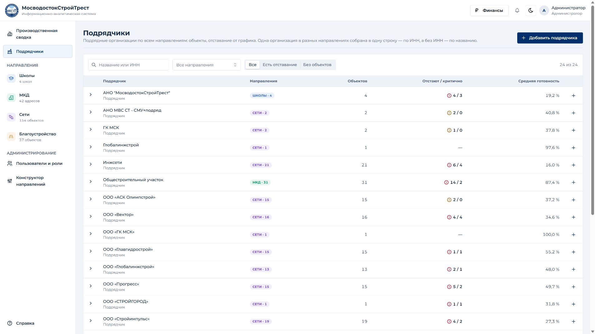
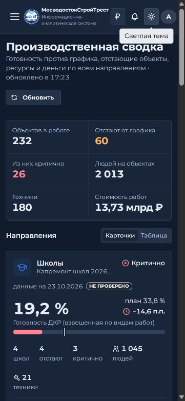

# Исправление слияния веток — 30.10.2026

Исходный main: `1f52ac3663a4045c6a63de93eb8bfeaa13c9159a`.
Все три рабочие ветки уже включены в main: feature/openlayers-map (PR #1), feature/contractors-finance-lag (PR #3), design/ui-refresh-mvsst-2026 (PR #4). Ветка docs/claude-md также ранее включена через PR #2.

## Причина поломки

В merge-коммите `a0dba32` остался JSX `<Brand />`, но был потерян импорт компонента в AppLayout.tsx. TypeScript воспроизводит `TS2304: Cannot find name 'Brand'`; production-сборка клиента не проходит.
При разрешении конфликтов также потерялись классы `header-actions` и `kpi-strip`. Возврат только одной из веток удалил бы часть уже объединённых возможностей, поэтому исправляется итоговый main.

## Исправление

- Восстановлен импорт Brand.
- Восстановлен класс шапки header-actions и полосы KPI kpi-strip.
- Сохранено динамическое количество KPI при скрытии финансов.
- Уплотнена мобильная шапка с новой кнопкой финансов; логотип и полное название сохранены.
- Подрядчики, переключатель финансов, знак отставания, карта и исходные обработчики не изменены.

## Проверки

- `npm run build` — успешно для shared, API, web.
- `npm run typecheck` — успешно во всех workspaces.
- `npm run test -w @mvs/api` — 16 из 16 тестов с отдельной локальной MySQL.
- Сводка загружается, значения KPI сохранены.
- Кнопка «Финансы» скрывает денежный итог, повторное нажатие его возвращает.
- Подрядчики: загружаются 24 организации из штатного тестового наполнения; раскрытие первой организации показывает четыре ссылки на объекты.
- Ширина 375 px: сводка и подрядчики без горизонтального переполнения страницы, все четыре действия в шапке доступны.
- Консоль проверенной вкладки — без ошибок и предупреждений.
- `git diff --check` — без ошибок.

Проверка локальная. Рабочий сервер, данные, API, схема БД и миграции не менялись. Сборка сохраняет прежние предупреждения о размере chunks и pure-комментариях zod.

