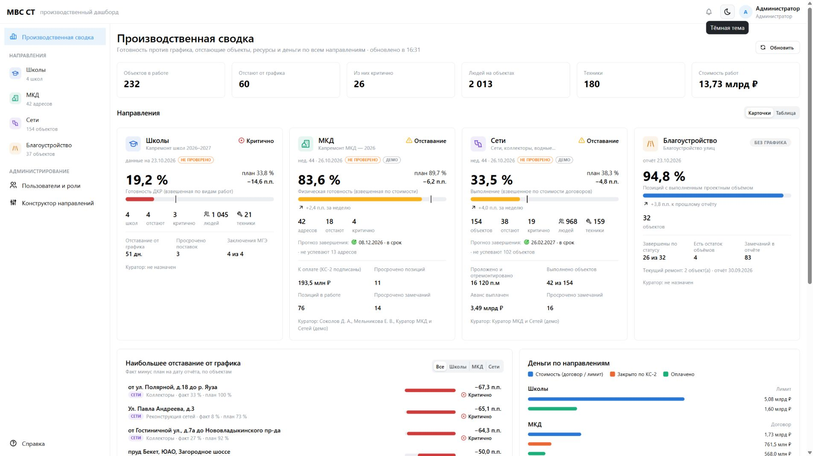
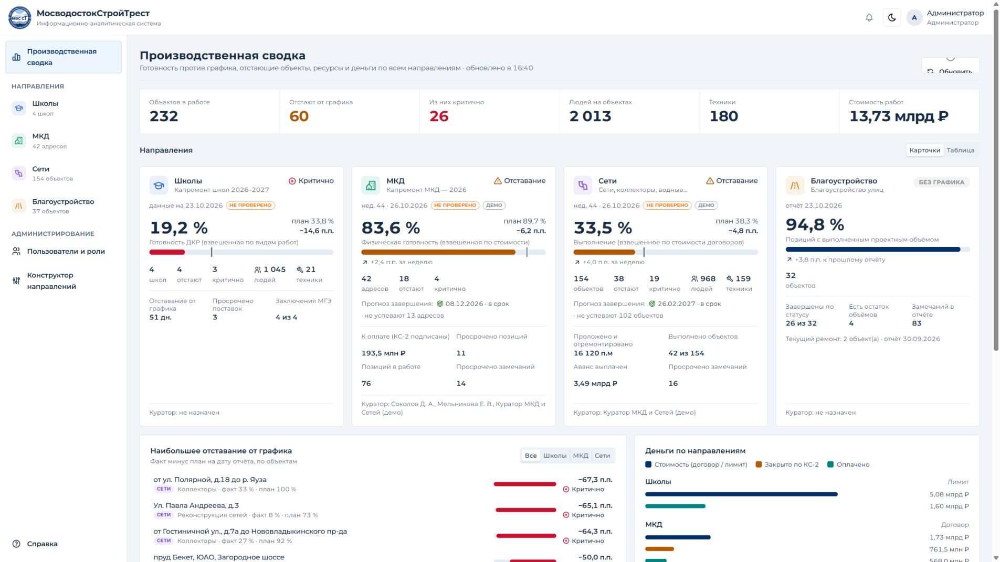

# Визуальная модернизация МосводостокСтройТрест

Ветка: `design/ui-refresh-mvsst-2026`. Исходный коммит: `fef111e`.
Проверка: 30.10.2026. Приложение: React 19, Mantine 8, ECharts, OpenLayers, Tabler Icons.

## Что обнаружено до изменений

| Приоритет | Место | Наблюдение | Решение |
|---|---|---|---|
| Высокий | Общая оболочка | Сокращённый бренд, нет официального знака | Полное название, подзаголовок, оригинальный SVG |
| Высокий | Сводка | Все итоговые числа одинакового визуального веса | Единая полоса KPI, акцент на отставании и критичных объектах |
| Высокий | Все страницы | Бледные подписи и слабое разделение страницы и карточек | Контрастные текстовые токены, спокойный фон, различимые поверхности |
| Средний | Направления | Вкладки занимают много строк на телефоне | На телефоне тот же набор вкладок в Select, с исходными URL и проверками доступа |
| Средний | Таблицы и формы | Недостаточно выраженные заголовки, неодинаковые границы и поля | Общий стандарт Mantine, табличные цифры, фон шапок, hover и фокус |
| Средний | Устройство направления | Таблица расширяет страницу на телефоне | Table.ScrollContainer со всеми исходными столбцами |
| Средний | Карточки объектов | React сообщает о вложенных p/div | Исправлены только типы JSX-контейнеров |
| Средний | Конструктор | Badge внутри абзаца вызывает ошибку разметки | Контейнер div без изменения действий |
| Средний | Доступность | Фильтры без доступных имён, строки доступны только мышью | Имена фильтров, Enter для открытия строки, skip link, подписи кнопок закрытия |
| Средний | Графики | Слабые подписи и неограниченные подсказки | Единые палитра, шрифт, легенды, отступы, confine tooltip, без анимации |

Начальные снимки сделаны в этой сессии на изолированном штатном наполнении репозитория.
Достоверные пары сравнения: сводка, четыре обзора направлений, реестр, матрица и ввод МКД.
Кадры загрузки не используются как подтверждение готового экрана; первоначальный снимок динамики сделан до завершения анимации и не служит сравнением графика.

## Дизайн-система и сохранённые особенности

- Брендбук, стр. 11: Royal Blue `#002F6C`, Sky Blue `#9BCBEB`. Исходный логотип скопирован без изменения SVG. Из него подготовлены PNG для установки приложения на телефон.
- Светлая тема: фон `#F1F4F8`, белые панели, текст `#192C43`, вторичный текст `#53647A`, границы `#D5DEE8`.
- Тёмная тема: фон `#101B2B`, панели `#192639`, текст `#E5EDF6`, подписи `#AEBED1`.
- Корпоративные зелёный и красный сохранены как смысловые оттенки. Оранжевый и тёмные варианты адаптированы для читаемости. Бизнес-критерии и пороги статусов не менялись.
- Шрифт: Montserrat, затем системный Segoe UI/Arial. Файлы фирменных шрифтов не предоставлены, внешние шрифтовые сервисы не подключаются. На компьютерах без Montserrat используется указанный резервный шрифт.
- Базовый размер 14 px, подписи 12–13 px, заголовки страниц 22 px, числовая полоса 20–28 px. Скругление 4–6 px, поля страницы 12–24 px.
- Существующие цвета направлений остаются из настроек: они определяют категории, а не состояние.
- Все исходные пояснения, даты, единицы, прогнозы, состав показателей и специфические вкладки сохранены. Правило навыка об удалении предложений не применяется к необходимым рабочим инструкциям, формулам и предупреждениям.
- Матрица сохраняет шкалу величины и знак просрочки. Не инвертировались значения и не вводились новые пороги ради рекомендаций навыка.
- Плотные таблицы используют ширину экрана; справка и редактор направления ограничены 1180 px. На широких мониторах сводка содержит четыре направления в одном ряду.

## Покрытие экранов

| Шаг | Экран | Результат |
|---|---|---|
| 1 | Сводка: KPI, карточки, проблемные объекты, деньги | Обновлена и проверена |
| 2 | Школы: все 12 доступных вкладок | Проверены |
| 3 | МКД: все 11 доступных вкладок | Проверены |
| 4 | Сети: все 12 доступных вкладок | Проверены |
| 5 | Благоустройство: все 10 доступных вкладок | Проверены, ограничение внешних тайлов ниже |
| 6 | Пользователи, форма добавления, конструктор и редактор, справка | Проверены desktop/mobile |
| 7 | Карточка объекта, паспорт, фильтрация и переход с клавиатуры | Проверены |
| 8 | Вход, смена пароля | Общая тема и фирменный блок применены; смена пароля не выполнялась |

Состав вкладок зависит от исходных возможностей и роли. Новых вкладок, функций, метрик и правил доступа нет.
Общая тема также применяется к существующим редакторам объектов, замечаний и надстроек, импорту, уведомлениям и окнам подтверждения. Полный цикл сохранения во всех этих окнах не проверялся.

## Сборка и проверки

- `npm run build`: успешно для shared, API и web.
- `npm run typecheck`: успешно для всех трёх workspaces.
- `npm run test -w @mvs/api`: 16 из 16 тестов, 4 файла.
- `npm run db:demo:verify -w @mvs/api`: все показатели совпадают с исходными эталонами. Разница плана на дату и плана на среду объясняется существующими правилами и проверяется engine.spec.ts.
- После последних исправлений выполнена повторная сборка web; см. `build-web.log`.
- `git diff --check`: без ошибок. `package.json`, lockfile, сервер, shared, миграции и deploy не менялись.
- Full HD: 45 доступных вкладок, переполнений страницы нет (`desktop-checks.json`).
- Тёмная тема: 45 вкладок, переполнений нет (`dark-checks.json`).
- Мобильная ширина 375: 45 вкладок. Первичный прогон выявил три переполнения «Устройства» (`mobile-checks.json`); после исправления повторный замер всех трёх прошёл (`responsive-checks.json`).
- 1366×768, 1920×1080, 2560×1440, 3440×1440, 375×812: сводка и обзоры всех направлений. 28 замеров с повторной проверкой исправлений — без переполнений страницы.
- Пользователи, конструктор, редактор и справка на 375 px — без переполнений (`service-mobile-checks.json`).
- Поиск объекта, пустой результат, обязательное ФИО, открытие карточки Enter, паспорт объекта, мобильная навигация и переключение темы работают.
- Контрольные числа сводки сохранены: 232 объекта, 60 отстающих, 26 критичных, 2 013 человек, 180 единиц техники, 13,73 млрд ₽.
- API-проверки четырёх штатных ролей: вход, доступные направления, сводка, лист ввода, запрет списка пользователей для не-ADMIN — см. `role-checks.json`. Визуальный обход сделан под ADMIN; полный браузерный обход каждой роли не выполнялся.
- После исправления разметки отдельная чистая вкладка повторно прошла все 45 вкладок: 0 ошибок и предупреждений (`console-checks.json`).

Сохранились исходные предупреждения сборки о размере chunks и комментариях pure в zod. Пакеты не обновлялись и новые зависимости приложения не добавлялись.

## Ограничения и сценарии для приёмки

Проверка локальная: отдельные MySQL на 3318, API на 3018 и web на 5180. В новую тестовую базу загружено штатное наполнение репозитория. Реальные данные не заменялись, рабочий сервер не использовался. Временный Vite-конфиг и данные БД не входят в Git.

Не проверены end-to-end: сохранение всех форм, переходы состояния недели, конфликты 409, импорт и скачивание файлов, полный жизненный цикл замечания с фото, изменение паролей и прав, работа офлайн/PWA на реальном устройстве, экранный диктор и принудительные контрастные режимы Windows. Полная WCAG-сертификация не заявляется.
На карте видны геометрия объектов и легенда; успешная загрузка внешней подложки OpenStreetMap не подтверждена — снимок показывает маркеры на белом фоне. Настройки источника тайлов не изменялись.
Некоторые подробные карточки различаются по объёму: сохранение исходных показателей важнее искусственно одинакового числа строк. На небольших экранах для всех деталей требуется вертикальная прокрутка.

## Сравнение до и после

### Производственная сводка, 1920×1080

До:

После:

### Направления

| Направление | До | После |
|---|---|---|
| Школы | [Исходный экран](screenshots/before/schools-overview.jpg) | [Обновлённый экран](screenshots/after/schools-overview.jpg) |
| МКД | [Исходный экран](screenshots/before/mkd-overview.jpg) | [Обновлённый экран](screenshots/after/mkd-overview.jpg) |
| Сети | [Исходный экран](screenshots/before/networks-overview.jpg) | [Обновлённый экран](screenshots/after/networks-overview.jpg) |
| Благоустройство | [Исходный экран](screenshots/before/streets-overview.jpg) | [Обновлённый экран](screenshots/after/streets-overview.jpg) |

[Матрица до](screenshots/before/mkd-matrix.jpg) · [Матрица после](screenshots/after/mkd-matrix.jpg) · [Ввод до](screenshots/before/mkd-entry.jpg) · [Ввод после](screenshots/after/mkd-entry.jpg).

[Тёмная тема](screenshots/after/overview-1920-dark.jpg) · [Телефон](screenshots/after/mkd-overview-375-dark.jpg) · [Ultrawide](screenshots/after/overview-3440-light.jpg).
Все снимки находятся в `screenshots/`; обзорные листы `qa-sheet-*` использованы для визуальной проверки набора экранов.

## Идеи за пределами дизайна — не реализованы

1. Виртуализация и серверная пагинация больших реестров: требуют отдельной проверки поведения и контрактов.
2. Сохранение наборов фильтров, массовые действия и персональные представления: новые продуктовые функции.
3. Дополнительные метрики, сопоставление периодов и изменение трактовки прогнозов: отдельное согласование формул.
4. Изменение жизненного цикла замечаний, прав и ответственности за данные: отдельная бизнес-задача.
5. Обновление зависимостей с устранением существующих npm audit замечаний: отдельная техническая задача.

Ни один из этих пунктов не включён в реализацию. Слияние в main и развёртывание не выполнялись.
